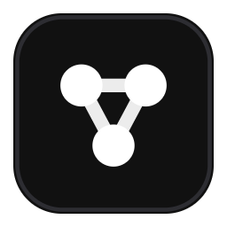
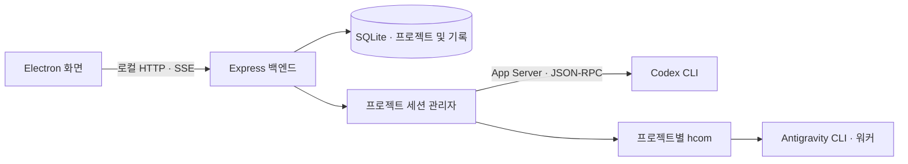

<div align="center">
  

  <h1>hcom_gui</h1>

  <p><strong>Codex와 Antigravity를 한곳에서 쓰는 Windows 작업 공간</strong></p>

  <p><a href="https://github.com/jehee826/hcom_GUI/releases/latest"><strong>↓ Windows x64 설치 파일 받기</strong></a></p>
</div>

---

hcom_gui는 PC에서 Codex와 Google Antigravity를 실행하고, 대화와 작업 진행 상황을 한 화면에 보여줍니다. 프로젝트 폴더를 바꾸면 각 폴더의 대화로 돌아갈 수 있고, 입력창에서 어느 AI에게 보낼지 고를 수 있습니다.

## 무엇을 할 수 있나요?

| 기능 | 할 수 있는 일 |
| --- | --- |
| **프로젝트별 작업 공간** | Git 저장소나 일반 폴더를 등록하고 각 프로젝트의 대화와 기록을 따로 관리합니다. |
| **Codex와 워커 대화** | Codex에 설계와 검토를 묻거나, Antigravity 워커를 선택해 구현과 테스트를 요청합니다. |
| **워커 추가와 설정** | 프로젝트에 워커를 추가하고 각 세션의 모델, 추론 강도, 작업 권한을 조정합니다. |
| **세션 이어서 사용** | 저장된 세션을 다시 열고, 진행 로그와 프로젝트 인계 내용을 확인합니다. |

## 시작하기

**준비할 것** · Windows x64 PC, [Codex CLI](https://learn.chatgpt.com/docs/codex/cli), [Antigravity CLI](https://antigravity.google/docs/getting-started?tab=cli), [hcom](https://github.com/aannoo/hcom). 각 CLI를 설치하고 Codex와 Antigravity에 로그인합니다. 새 명령 프롬프트에서 `codex --version`, `agy --version`, `hcom --version`이 실행되면 준비가 끝납니다.

1. [최신 릴리즈](https://github.com/jehee826/hcom_GUI/releases/latest)에서 `hcom_gui-<버전>-x64-setup.exe`를 내려받아 설치합니다.
2. 왼쪽의 **새 프로젝트 등록**에서 작업할 폴더를 고르고, 등록한 프로젝트를 **시작**합니다.
3. 입력창의 **전송 대상**에서 **Codex** 또는 **Antigravity 워커**를 선택하고 메시지를 보냅니다. 예를 들어 Codex에는 “이 프로젝트의 구조를 설명해줘”, 워커에게는 “이 함수의 테스트를 추가해줘”라고 요청할 수 있습니다.
4. 오른쪽 **워커** 영역에서 진행 상황을 보거나 새 워커를 추가합니다. 다음에 돌아오면 프로젝트를 선택해 저장된 세션을 다시 사용합니다.

> 첫 사용 전에 각 AI의 작업 권한을 확인하세요. 쓰기가 허용된 세션은 PC의 파일을 수정할 수 있습니다.

---

<details>
<summary><strong>개발자용 · 내부 동작, 아키텍처, 빌드 및 릴리즈</strong></summary>

### 내부 동작



프로젝트별 `HCOM_DIR`과 저장된 세션 ID로 참가자와 메시지를 구분합니다. 작업 기록은 SQLite에 저장합니다. Windows 앱과 로컬 개발 화면은 같은 웹 자산을 사용합니다. 세션 격리는 메시지와 기록에 적용되며, 파일 접근 범위는 각 세션의 권한 설정을 따릅니다.

[아키텍처 상세](docs/design/architecture.md) · [구현 계획](docs/plan/plan.md)

### 로컬 개발

Node.js 24가 설치된 Windows 환경에서 실행합니다.

```cmd
npm ci
npm run typecheck
npm test
npm run dev:web
```

설치 파일은 Windows에서 `npm run dist`로 빌드합니다. 결과는 `release/` 아래에 생성됩니다.

### 릴리즈 방식

- `main`은 기본 브랜치입니다. 개발에는 `feat/...`, `fix/...` 같은 작업 브랜치를 사용합니다.
- 버전 확정 시 `V1.0.0`, `V1.1.0`, `V1.2.0` 형식의 버전 브랜치를 만들고 릴리즈 후에도 보존합니다.
- 버전 브랜치에서 `package.json`과 `package-lock.json` 버전을 맞추고, [릴리즈 노트](.github/release-notes/)에 **추가기능**과 **버그픽스**를 점 목록으로 작성합니다.
- 버전 브랜치가 `main`에 병합되면 [GitHub Actions](.github/workflows/release.yml)가 검사와 Windows 빌드를 실행하고, 병합 커밋에 `v1.0.0` 형식의 태그를 붙여 설치 파일과 SHA-256 체크섬을 게시합니다.

</details>
