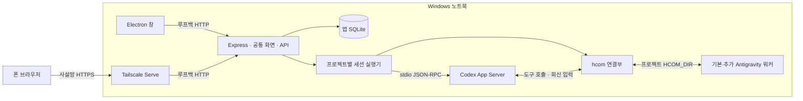

# hcom_gui 요구사항과 아키텍처

Windows 노트북에서 로컬 Git 프로젝트를 선택하면 그 프로젝트 전용 Codex와 Antigravity CLI(`agy`) 세션을 시작하거나 재개한다. 데스크톱과 폰은 같은 노트북 백엔드에 접속한다. 사용자는 Codex에 지시하고, Codex는 설계·작업 분배·검토를, 기본 및 추가 Antigravity 워커는 구현·테스트를 맡는다.

## 1. 요구사항과 화면

### MVP

| 요구사항 | 동작 |
| --- | --- |
| 프로젝트 등록·격리 | 노트북에서 기존 로컬 Git 폴더를 등록하고 양쪽 화면에서 선택한다. 프로젝트마다 전용 Codex 스레드 하나와 기본 `agy` 워커 하나를 둔다. 세션·참가자 목록·메시지·기록은 소속 프로젝트에만 표시하고 전달한다. |
| 시작·재개 | 첫 시작에는 새 대화 ID를 저장한다. 실행 중이면 기존 연결을 표시하고, 중지된 경우 저장된 ID로 재개한다. 프로젝트당 활성 Codex 하나, 기본·추가 워커 각각에 활성 세션 하나를 유지한다. 창 닫기, 프로젝트 전환, 폰 재접속은 실행 상태를 바꾸지 않는다. |
| 지시·답변 | 선택된 프로젝트에 자연어를 보내고 Codex의 진행 상태와 답변을 본다. 프로젝트별 사용자 요청은 한 번에 하나를 진행한다. A와 B는 서로 독립적으로 동시에 진행할 수 있다. |
| 워커 추가·상태 | 사용자가 `워커 추가`를 누르면 선택된 프로젝트에 이름을 붙인 `agy` 워커를 추가할 수 있다. 각 워커는 별도 세션과 hcom 참가자 ID를 가지며 준비·작업 중·사용자 조치 필요·중지·연결 끊김을 개별 표시한다. |
| 작업 전달·회신 | Codex가 같은 프로젝트의 워커 중 하나를 지정해 hcom으로 작업을 보낸다. 해당 워커가 회신하고 Codex가 검토한다. |
| 인계 기록·폰 접속 | 프로젝트별로 목표, 설계 문서 경로, 브랜치/커밋, 테스트 결과, 다음 작업을 보존한다. 폰은 승인된 사설망과 앱 인증을 거쳐 같은 지시 화면을 사용한다. |

**역할 경계.** 같은 프로젝트 안에서도 Codex와 각 Antigravity 워커는 별도 세션과 hcom 참가자로 실행한다. Codex는 설계·분배·검토를 맡으며, 구현 파일 수정과 테스트 실행은 지정된 워커가 맡는다.

**화면 흐름.** 노트북에서 폴더 등록 → 프로젝트 선택 → `시작` 또는 `재개` → 지시·답변 확인. 추가 인력이 필요하면 현재 프로젝트의 `워커 추가`를 열어 이름을 지정한다. 전송 버튼 옆에 대상 프로젝트명을 보여주고, 응답이 진행 중이어도 프로젝트를 전환할 수 있다.

**데스크톱 화면.** Windows Codex 앱의 화면 구성을 참고해 왼쪽에 접을 수 있는 프로젝트 사이드바, 가운데에 선택된 Codex 대화와 하단 지시창, 오른쪽에 접을 수 있는 워커·인계 패널을 둔다. 사이드바의 프로젝트 항목에서 세션 상태를 확인하고, 오른쪽에서 워커별 상태와 `워커 추가`를 찾는다. 화면은 `hcom_gui` 이름, 청록색 강조색과 자체 아이콘을 사용한다. [Windows Codex 앱 화면 구성](https://learn.chatgpt.com/docs/changelog?type=chatgpt-desktop-app#codex-app-for-windows)

**폰 화면.** 인증 후 상단 메뉴에서 프로젝트를 고르고 같은 대화와 하단 지시창을 사용한다. 워커 목록·추가와 인계 기록은 상단에서 여는 패널에 담는다. 데스크톱과 폰은 같은 화면 자산을 사용한다.

**다음 단계.** 한 프로젝트 안에서 여러 워커의 병렬 작업, 상세 로그, 알림, 인계 내보내기, worktree 생성·선택 UI, 폰에서의 권한 승인. MVP는 이미 존재하는 worktree의 소속을 유지한다.

**제외 범위.** 다중 사용자, 공개 접속, 클라우드 실행 호스트, 자체 AI 오케스트레이터, 에이전트별 OS 파일 접근 격리, 자동 커밋·푸시·배포. MVP의 세션 지속 범위는 앱이 트레이에서 실행되는 동안이다. 로그아웃·노트북 재부팅·백엔드 종료 시 진행 중인 작업은 중단될 수 있으며, 다시 앱을 열면 기록을 대조하고 같은 대화 ID로 재개한다.

## 2. 구성과 기술 스택

**Electron + TypeScript + Express + SQLite**를 제안한다. Electron의 Chromium 창과 폰 브라우저가 Express에서 제공하는 같은 반응형 HTML/CSS/TypeScript 화면을 사용한다. 전송은 HTTP, 응답·상태는 SSE로 처리한다. Node 런타임 하나로 Windows 앱, HTTP 서버, 자식 프로세스를 다룰 수 있다. SQLite는 등록 정보와 요청·인계 기록을 한 트랜잭션으로 보존할 수 있다. 폰 접속에는 Tailscale Serve를 사용한다. [Electron 앱 수명주기](https://www.electronjs.org/docs/latest/api/app) · [Tailscale Serve](https://tailscale.com/docs/features/tailscale-serve)

| 구성 | 책임 |
| --- | --- |
| Electron 메인 프로세스 | 단일 앱 인스턴스, 네이티브 폴더 선택, 창과 트레이 관리. 창 종료는 UI 연결만 끊는다. 트레이에서 앱을 종료할 때만 백엔드를 종료한다. |
| 로컬 백엔드 | 인증, 프로젝트 등록, 요청 수락, 기록 조회, 프로젝트 단위 SSE. 인증된 데스크톱·폰이 같은 상태를 읽는다. |
| 프로젝트별 세션 실행기 | 저장된 ID로 재개하고 프로세스 생존과 중복 시작을 확인한다. 프로젝트마다 전용 App Server 자식 프로세스를 stdio로 연결하고, 기본·추가 `agy`의 세션을 개별 관리한다. `hcom agy --headless` 실행은 검증 대상이다. |
| hcom 연결부 | 각 프로젝트의 Codex를 논리적 hcom 참가자 하나로 등록한다. Codex에 해당 프로젝트의 워커 목록과 상태를 제공하고, 지정된 워커에만 작업을 보내며 회신을 수집한다. 워커 선택·작업 분배·검토는 Codex가 결정한다. |

### 프로젝트 소속, 저장, 복구

**프로젝트 키.** 등록 시 Windows 절대 경로와 Git 공용 디렉터리의 실제 경로를 해석한다. `git rev-parse --path-format=absolute --git-common-dir`를 사용해 연결된 worktree와 원본을 같은 UUID에 묶는다. `cwd`는 Codex 및 워커별로 보관한다. 기존 worktree로 옮길 때는 동일한 Git 공용 디렉터리인지 확인하고, 해당 세션의 턴과 관련 위임 작업이 모두 끝난 뒤 같은 대화 ID로 새 `cwd`를 적용한다. `agy`가 새 `cwd`에서 같은 대화 ID를 허용하는지는 검증 대상이다. 재개 또는 연결 확인에 실패하면 그 상태를 표시하고 기존 경로를 유지한다. [Git rev-parse](https://git-scm.com/docs/git-rev-parse)

**격리.** `HCOM_DIR`은 예를 들어 `%LOCALAPPDATA%\hcom_gui\projects\<projectId>\hcom`이다. 각 프로젝트의 Codex와 모든 `agy` 워커, 자식 프로세스·훅, hcom 조회·전송 호출에 이 절대 경로를 개별 환경 변수로 전달한다. 전역 환경 변경이나 기본 디렉터리로의 폴백을 허용하지 않는다. 저장된 Codex `threadId`와 `agy` conversation ID는 각각 하나의 프로젝트에만 귀속된다. 백엔드는 `projectId`로 Codex를, `(projectId, workerId)`로 워커와 해당 hcom 참가자를 찾는다. 프로젝트가 다른 대상은 전송 전에 거절한다. 참가자 한 명을 정확히 지목하며 hcom relay는 끈다. `HCOM_DIR`은 통신·기록의 구분이며, 에이전트 파일 권한은 각 CLI의 샌드박스와 승인 설정이 결정한다. [hcom 프로젝트별 격리](https://github.com/aannoo/hcom#per-project-isolation)

**추가 워커.** 사용자 추가 요청을 접수하면 프로젝트 안에 새 `workerId`와 이름을 등록하고 새 `agy` 세션을 연결한다. 추가 요청의 재전송은 같은 워커 등록으로 처리한다. 시작 실패는 그 워커의 상태로 표시하고, 재시도는 같은 등록과 저장된 대화 ID를 사용한다. 기본 워커와 기존 Codex는 계속 같은 세션을 사용한다. 프로젝트 시작 시 Codex와 기본 워커를 시작하거나 재개한다. 추가 워커는 목록에서 각각 시작·재개할 수 있다.

**기록.** SQLite에 `projectId`로 구분된 등록 정보, Codex 및 워커별 세션, 사용자 요청과 Codex 턴, `workerId`가 연결된 hcom 작업·회신 참조, 인계 기록을 둔다. 인계에는 목표, 프로젝트 상대 설계 문서 경로, 작업 시점의 브랜치와 커밋, 테스트 명령과 결과, 다음 작업을 남긴다. 커밋 없음·테스트 미실행·결과 미확인은 상태로 표현한다. 워커 보고와 Codex 검토를 함께 보존하고, 검토가 끝난 뒤 최신 인계를 갱신한다. UI 전송용 이벤트는 저장한 뒤 발행하며 프로젝트별 커서로 재생한다.

**중복 방지.** 같은 프로젝트의 Codex 슬롯 또는 같은 `workerId`에 대한 시작·재개를 직렬화한다. 살아 있는 세션에는 재연결하고, 중지 확인 후에만 저장된 ID로 재개한다. PID 단독으로 소유권을 판단하지 않는다. 폰·데스크톱 재전송에는 원래 `requestId`를 재사용하고 `(projectId, requestId)`당 한 번만 접수한다. 전송 직후 연결이 끊겨 상위 프로토콜 접수 여부가 모호하면 `확인 필요`로 기록한 뒤 저장된 턴·이벤트를 대조한다. 이미 실행됐는지 불명확한 요청을 자동 재전송하면 작업이 두 번 실행될 수 있다.

**폰 인증.** Express는 `127.0.0.1`에만 바인딩한다. Tailscale 정책에서 승인된 사용자·폰의 노트북 Serve 접근을 허용하고, broad allow 규칙이 이 제한을 무효화하지 않는지 확인한다. Funnel과 공유 링크는 사용하지 않는다. 폰은 데스크톱에서 발급한 만료·일회용 페어링 코드로 별도 앱 세션을 얻고, HTTPS의 `Secure`, `HttpOnly`, `SameSite` 쿠키로 인증한다. 데스크톱은 Electron 메인 프로세스에서 루프백 전용 세션을 받는다. 양쪽 모두 변경 요청의 `Origin` 검증과 인증을 적용하고, 폰에는 로컬 경로 등록과 승인 기능을 열지 않는다. 노트북이 잠들거나 네트워크가 끊기면 폰 화면에 연결 끊김을 표시한다. [Tailscale Serve](https://tailscale.com/docs/features/tailscale-serve) · [Tailscale 접근 정책](https://tailscale.com/docs/features/access-control/grants) · [Electron 보안](https://www.electronjs.org/docs/latest/tutorial/security)

## 3. Codex 입력과 출력

### 권장 경로와 문서로 확인한 사실

**입력.** 앱은 `projectId`와 `requestId`를 받아 서버에 저장된 `threadId`를 조회한다. App Server는 노트북 사용자의 로컬 Codex 인증을 사용한다. `initialize` 후 `thread/start` 또는 ID를 지정한 `thread/resume`으로 연결하고, `turn/start`에 `threadId`와 지시를 전달한다. 반환된 `turn.id`를 요청에 연결한다. 이때 화면 상태는 `Codex 접수`로 바뀐다. [OpenAI Codex App Server의 스레드·턴·인증 API](https://learn.chatgpt.com/docs/app-server)

**출력.** `item/agentMessage/delta`는 진행 중 텍스트에 사용한다. 같은 `threadId`·`turnId`의 `item/completed`에서 `agentMessage` 본문을 저장하고, `phase: final_answer`와 성공한 `turn/completed`를 함께 확인해야 최종 답변으로 표시한다. `phase`는 선택 필드다. 누락 시 공식 이력 API로 재조회하고, 선택 버전에서 검증된 규칙으로도 판별할 수 없으면 `턴 완료 · 최종 답변 확인 필요`를 표시한다. 실패·중단, 본문 누락은 각각 구분한다. 끊긴 뒤에는 `thread/turns/list` 등 공식 이력으로 대조한다. [OpenAI Codex App Server의 알림·이력](https://learn.chatgpt.com/docs/app-server)

**에이전트 왕복.** App Server에 프로젝트 워커 조회와 전송 도구를 등록한다. Codex는 자기 프로젝트의 워커 목록에서 대상을 고르고 `workerId`로 위임한다. 전송 도구는 현재 요청과 워커 소속을 확인한 뒤 해당 Codex의 참가자 명의로 `hcom send`를 실행한다. MVP는 사용자 요청 하나당 위임 작업 하나를 처리한다. 백엔드는 도구 호출 ID, 사용자 요청 ID, 대상 `workerId`, hcom 발신 이벤트 ID를 연결한다. `agy`는 원본 이벤트를 참조해 그 Codex 참가자에게 hcom으로 결과를 보낸다. 연결부는 발신·수신 참가자와 `reply_to`가 일치하는 결과 회신을 저장하고 중복·단순 수신 확인을 걸러낸다. Codex가 위임 턴을 끝내면 같은 스레드에 `turn/start`의 `toolOutput`으로 회신을 넣어 검토 턴을 시작한다. 작업이 있는 요청에서 위임 턴의 답변은 진행 메시지로 남기고, 검토 턴의 성공과 최종 본문이 확인돼야 요청 전체를 완료한다. [hcom 전송 옵션과 이벤트](https://github.com/aannoo/hcom/blob/main/src/commands/send.rs) · [OpenAI Codex App Server의 도구 결과·동적 도구](https://learn.chatgpt.com/docs/app-server)

`hcom send --json`의 `event_id`·`delivered_to`는 hcom 쪽 전송 처리의 증거다. 워커의 처리 완료는 대응 회신, 최종 답변 수신은 Codex 완료 이벤트와 본문으로 각각 확인한다. 연결부에서 `hcom events --follow --full --after-id`의 마지막 처리 ID를 저장해 회신을 재조회한다. hcom DB가 교체되어 이벤트 ID가 초기화되면 이전 커서를 격리하고 해당 프로젝트에 복구가 필요하다고 표시한다. [hcom 변경 이력](https://github.com/aannoo/hcom/blob/main/CHANGELOG.md) · [hcom 이벤트 명령 소스](https://github.com/aannoo/hcom/blob/main/src/commands/events.rs)

### 대안과 확인이 필요한 조합

| 경로 | 확인된 인터페이스와 판단 |
| --- | --- |
| hcom 관리형 Codex | `hcom codex`로 연결하고 hcom의 정확한 수신자를 지정할 수 있다. 이벤트·상태·기록은 진단 근거다. 이 경로를 채택하려면 hcom 도착 증거와 별도로 Codex 공식 `notify`의 `agent-turn-complete`, `thread-id`, `turn-id`, 답변 본문을 일치시켜야 한다. 터미널 화면 파싱으로 최종 답변을 판정하지 않는다. [hcom 사용법](https://github.com/aannoo/hcom) · [Codex notify](https://learn.chatgpt.com/docs/config-file/config-advanced#notifications) |
| Codex SDK / `codex exec` | TypeScript SDK는 ID로 재개하고 `finalResponse`를 제공한다. `exec`는 비대화형 실행에서 JSONL 또는 `--output-last-message`를 제공한다. 이 둘은 단일 턴 대조 실험에 사용할 수 있다. 지속 연결과 승인·턴 이벤트가 필요한 주 경로에는 App Server를 선택한다. [Codex SDK](https://learn.chatgpt.com/docs/codex-sdk) · [Codex 비대화형 모드](https://learn.chatgpt.com/docs/non-interactive-mode) |

**Windows에서 실험할 가정.** `hcom codex` 래퍼의 자동 훅이 독립 App Server에서도 활성화된다는 근거는 확인되지 않았다. 주 경로는 일반 Codex의 수동 참가 방식에 기대므로, 확정된 `threadId`로 수동 참가자를 등록·재사용할 수 있는지, 동일 참가자 명의의 발신과 `agy` 자동 수신·회신이 맞물리는지 검증한다. `dynamicTools`는 공식 문서상 실험적 기능이다. 고정 버전에서 등록·재개·호출 ID와 최종 메시지의 `phase`를 확인한다. `agy --conversation <id>`는 공식 재개 인터페이스이며, hcom을 거친 백그라운드 실행에서 정확한 ID 발견·재개와 승인 대기 처리가 되는지는 별도 검증한다. [hcom 수동 참가 소스](https://github.com/aannoo/hcom/blob/main/src/commands/start.rs) · [OpenAI Codex App Server](https://learn.chatgpt.com/docs/app-server) · [Google Antigravity CLI](https://antigravity.google/docs/cli/reference/)

**승인 처리.** MVP는 Codex의 권한 요청을 상태로 노출하고 별도 승인 UI가 필요한 요청은 거절 또는 취소한다. `agy`는 승인 필요를 상태로 표시하고 사용자가 노트북의 로컬 세션에서 처리하는 경로를 검증한다. 그 경로를 확보하지 못하면 해당 작업은 중지·재개 대상으로 남긴다. 처음 검증할 브랜치 조회는 읽기 전용이다. [Codex App Server 승인 규약](https://learn.chatgpt.com/docs/app-server#approvals) · [Antigravity 실행 모드](https://antigravity.google/docs/cli/reference/#command-line-flags)

단계별 통과 기준은 [구현 계획](../plan/implementation-plan.md)에 정의한다.
