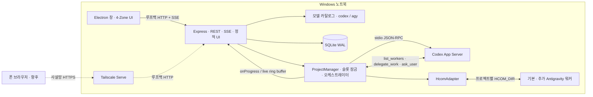

# hcom_gui 요구사항과 아키텍처

Windows 노트북에서 로컬 프로젝트 폴더(Git 저장소 또는 일반 폴더)를 등록하면 프로젝트마다 독립된 `HCOM_DIR`, Codex App Server 스레드, 기본 및 추가 Antigravity CLI(`agy`) 워커 세션을 격리 실행·재개한다. 사용자는 Codex에 지시하거나 필요 시 개별 워커와 직접 대화하며, Codex는 설계·작업 분배·멀티라운드 검수·재지시를, Antigravity 워커는 구현·테스트를 맡는다.

## 1. 요구사항과 UI 구조

### 핵심 기능

| 영역 | 동작 |
| --- | --- |
| 프로젝트 등록·격리 | 로컬 Git 저장소(worktree 포함 동일 저장소 중복 방지) 또는 일반 폴더(`dir:<path>`)를 등록한다. 프로젝트마다 전용 `HCOM_DIR`, Codex 스레드 1개, 기본 `agy` 워커 1개를 두며 세션·목록·메시지·인계 기록을 프로젝트 단위로 완전 격리한다. |
| 세션 시작·재개 | 첫 시작 시 대화 ID(`threadId`, `conversationId`)를 SQLite에 저장한다. 실행 중이면 기존 연결을 재사용하고 중지 시 저장된 ID로 재개한다. 창 닫기(트레이 상주)·프로젝트 전환·재접속은 실행 상태를 끊지 않는다. |
| 멀티라운드 오케스트레이션 | 사용자 요청 1건(`requestId`) 안에서 `Codex 판단 → 워커 위임(delegate_work) → 워커 회신 → Codex 검수 → (통과 시 최종 답변 1회 / 보완 필요 시 N차 재지시 / 사용자 판단 필요 시 ask_user로 대기 후 이어가기)` 흐름을 완결한다. |
| 모델 · 추론 속도 · 권한 제어 | 로컬 `codex`(`model/list`)와 `agy models`에서 실제 모델·추론 강도 목록을 조회한다. Codex(`model`, `reasoningEffort`, `sandboxMode`)와 각 워커(`model`, `reasoningEffort`, `permissionMode`)를 개별 설정·저장한다. |
| 실시간 생각 로그 & 원격 승인 | Codex 추론·진행 설명·명령·파일 변경·도구 호출과 워커의 상태·`hcom transcript` 로그를 실시간/온디맨드로 확인한다. 등록 폴더는 기본 신뢰·자동 진행(`always-proceed`)을 적용하며, 승인 프롬프트 발생 시 `waiting_approval` 상태에서 앱 내 `승인`/`거절` 버튼으로 원격 복구한다. |
| 워커 확장 · 직접 대화 | 프로젝트별 추가 워커(`workerId`, 독립 `conversationId`·모델·권한·worktree `cwd`)를 생성·시작·중지·재개한다. 사용자는 Codex 경유 외에 개별 워커와 직접 대화할 수 있다. |
| 인계 기록 · 설치형 업데이트 | 프로젝트별 목표·설계 문서·브랜치/커밋·테스트 결과·다음 작업·최근 워커 보고/Codex 검토를 보존한다. Windows NSIS 설치형 `.exe` 단일 타깃으로 배포하며 기존 데이터를 유지한 제자리 업데이트를 지원한다. |

### 화면 구성 (Codex Desktop 스타일 라이트 모노크롬)

Windows Codex Desktop 앱의 시각 언어(순백 캔버스 `#FFFFFF`, 초경량 연회색 사이드바 `#F9F9FA`, 헤어라인 경계선 `#EBEBEF`, 짙은 흑색 본문 `#0D0D0D`, 무채색 pill 강조)를 따르는 **4-Zone 레이아웃**을 채택한다.

1. **좌측 아이콘 레일 (`48px`)**: 브랜드 엠블럼, 프로젝트/진단/인계/hcom 로그/업데이트 빠른 전환 아이콘.
2. **좌측 프로젝트 사이드바 (`~232px`, 접이식)**: 상단 `hcom_gui` 헤더·필터/검색, `+ 새 프로젝트 등록`, 폴더별 프로젝트 목록(상태 점·브랜치 요약·활성 항목 soft pill).
3. **중앙 대화 캔버스 (유연 폭, `#FFFFFF`)**:
   - **미니멀 상단 헤더 (`44px`)**: 프로젝트 이름·브랜치·세션 상태 pill과 우측 `시작/재개`·`중지`·더보기·우측 패널 토글 아이콘만 배치해 수직 공간을 최대화한다.
   - **플랫 대화 피드 (`max-width: 740px`)**: 사용자 메시지는 우측 정렬 연회색 말풍선(`#F3F3F5`), AI 응답은 외곽 박스 테두리 없이 흰 캔버스 위에 직접 흐르며 경량 마크다운/코드 블록 카드(`복사` 버튼 포함)를 XSS-safe DOM으로 렌더링한다. 응답 상단에는 실행 중 펄스 점 + 1줄 추론 요약과 `▾` 상세 로그 토글을 둔다. `waiting_user` / `waiting_approval` 시에만 인라인 액션 카드를 노출한다.
   - **하단 플로팅 컴포저 (`border-radius: 20px`)**: 상단 자동 확장 입력창 + 하단 통합 툴바(좌측: 대상 전환 `+` 버튼 · Codex 권한 선택 / 우측: Codex 모델 · 추론 속도 선택 · 원형 검정 전송/중지 버튼).
4. **우측 플로팅 인스펙터 카드 (`~288px`, 둥근 독립 카드, 접이식)**: Codex 앱의 `결과물 / 하위 에이전트 / 소스` 구성을 `hcom_gui` 도메인에 맞춰 재배치한다.
   - **워커 (상단 메인 섹션 + `+` 추가 버튼)**: 기본은 1줄 요약으로 접혀 있으며, `▾` 펼침 시 모델·추론·권한 설정, 시작/중지/재적용, 온디맨드 생각·도구 로그(`hcom transcript` + 라이브 이벤트), 워커 전용 직접 대화 입력창이 열린다.
   - **활동 요약 (`hcom`)**: 활성 워커·위임 현황 요약 및 접이식 `hcom 세션 메시지` 스트림.
   - **프로젝트 · 인계**: 브랜치·커밋·`HCOM_DIR` 격리 정보와 접이식 인계 기록 편집.

**모바일 / 좁은 화면.** 데스크톱과 동일한 반응형 HTML/CSS/TS 자산을 사용하며 좌우 사이드바는 오버레이 드로어로 전환한다.

## 2. 시스템 구성과 기술 스택

**Electron 44 + TypeScript + Express + SQLite(`node:sqlite`)** 단일 런타임으로 구성한다.

| 모듈 | 책임 |
| --- | --- |
| `electron/` | 단일 앱 인스턴스 락, 네이티브 폴더/설치 파일 선택, 창·트레이 수명주기(창 닫기 시 백엔드 유지), 제자리 `.exe` 업데이터(`ELECTRON_RUN_AS_NODE` 제거) |
| `src/server/` | `127.0.0.1` 루프백 전용 Express 서버, 세션 토큰(`X-Hcom-Token`/`Bearer`)·`Origin`·CSP 보안, CLI 진단(`diagnostics.ts`), 실시간 모델 카탈로그(`models.ts`), 영속 커서 SSE + 임시 라이브 진행 SSE(`/api/projects/:id/events`) |
| `src/store/` | `node:sqlite` WAL 저장소. `projects`, `codex_sessions`, `workers`, `requests`, `delegations`, `hcom_cursors`, `handoffs`, `project_events` 관리 및 안전한 컬럼 자동 마이그레이션 |
| `src/runtime/` | `KeyedLock` 기반 슬롯 직렬화, `ProjectManager` 멀티라운드 루프(`delegate_work`, `ask_user`, 회신 압축·중복 방지 `claimDelegationReply`, `resumePendingRequests`), 실시간 링버퍼 로그(`subscribeLive`), 승인 대기 복구(`resolveWorkerApproval`), 참가자 캐시 |
| `src/codex/` | 프로젝트별 Codex App Server stdio JSON-RPC 연결, `model`/`effort`/`sandbox` 동적 갱신(`setRuntimeConfig`), 턴 ID·`phase: final_answer` 대조, `thread/turns/list` 누락 복구 |
| `src/hcom/` | 프로젝트 `HCOM_DIR`·세션 환경 격리(`session-env.ts`), `hcom agy` / `hcom r` 실행·ConPTY 화면 안정화(`settleWorker`, 배너·입력 막힘 복구), `injectInput`, `readTranscript`, 이벤트 스트림 구독 |

## 3. 프로젝트 격리 · 복구 · 성능 설계

### 격리와 데이터 무결성

- **프로젝트 키:** Git 저장소는 `git rev-parse --path-format=absolute --git-common-dir`로 worktree와 원본을 같은 프로젝트 UUID로 묶고, 일반 폴더는 `dir:<normalizedPath>` 키로 등록한다.
- **`HCOM_DIR` 격리:** `%LOCALAPPDATA%\hcom_gui\projects\<projectId>\hcom`을 모든 Codex·`agy`·`hcom` 자식 프로세스에 명시 전달하며, 부모 세션 식별자(`CODEX_*`, `HCOM_*`, `ANTIGRAVITY_*`, `GEMINI_*`, `CLAUDE*`)는 제거한다.
- **전역 소유권 제약:** `threadId`, `conversationId`, `(projectId, requestId)`, `(projectId, replyEventId)`에 고유 제약을 두어 교차 프로젝트 접근·대화 ID 재사용·회신 중복 검수를 원천 차단한다.
- **worktree 실측 반영:** `Codex 0.162.1`은 기존 `threadId`로 타 worktree `cwd` 전환이 가능하나, `agy 1.5.18`은 기존 `conversationId`의 타 `cwd` 재개를 지원하지 않는다. 따라서 worktree 작업은 동일 프로젝트(`HCOM_DIR`) 안에서 해당 worktree 경로로 새 워커를 추가해 수행한다.

### Codex ↔ hcom ↔ `agy` 오케스트레이션

1. **동적 도구 계약:** Codex 스레드에 `list_workers`(워커별 핵심 필드만 담은 경량 JSON), `delegate_work`(선택 워커에 `hcom send` 전달 + 회신 규칙 부착), `ask_user`(`waiting_user` 전환 및 선택지 제공) 3종을 등록한다.
2. **멀티라운드 루프 & 사용자 지침 기반 유연 제어:** 워커 회신이 도착하면 `claimDelegationReply`로 1회 처리 권리를 원자적으로 확보하고, `summarizeWorkerReplyForCodex`(결과·변경 파일·테스트 요약 위주)로 압축해 같은 Codex 스레드의 다음 `toolOutput` 턴에 주입한다. 검수 강도나 위임 스타일은 앱 코드가 강제로 보일러플레이트를 붙이지 않고, 사용자가 원할 때 설정하는 선택형 **사용자 지침**으로 유연하게 제어한다.
3. **승인 대기 복구:** 워커 설정(`agy-settings*.json`)에 프로젝트 등록 폴더 `trustedWorkspaces`와 워커별 `permissionMode`를 기록한다. 실행 중 `blocked` 상태가 2.5초 이상 지속되면 요청을 실패 처리하지 않고 `waiting_approval`로 전환하며, 사용자가 앱에서 승인/거절을 누르면 `hcom term inject`로 `\r` 또는 `\x1b`를 전달해 즉시 이어간다.

### 성능 · 배터리 최적화 및 개발 워크플로 원칙

- **이벤트 기반 대기:** `waitForWorkerReply`는 `hcom events --follow` 수신 즉시 대기자를 깨우며, 터미널 상태 보조 확인은 작업 미시작 시에만 지수 백오프(`4s → 8s → 15s`)로 최소화한다.
- **초기 로드 분리 · 비동기 진단:** `GET /api/projects/:id`는 최근 요청 이력만 우선 반환하고(이전 이력은 페이지네이션), CLI 진단(`where`·`--version`)은 비동기 실행 + 인메모리 캐시로 분리해 초기 화면 표시를 막지 않는다.
- **부분 갱신 · 델타 SSE:** 고빈도 추론/출력 델타는 인메모리 링버퍼 + 80ms 스로틀 SSE로 전달하고 완료 시 요약만 SQLite에 1회 저장한다. 구조 변경 SSE(`request.*`, `worker.*`, `codex.*`)도 변경된 엔티티를 실어 프론트엔드가 전체 재조회 없이 바뀐 DOM 슬롯만 120ms/`requestAnimationFrame`으로 부분 패치한다. 창이 숨겨지면(`document.visibilitychange`) DOM 렌더링을 중단하고 복귀 시 1회 동기화하며, 워커 상세 로그는 카드가 펼쳐질 때만 온디맨드로 불러온다.
- **3단계 검증 흐름:** `npm run dev:web`(브라우저 즉시 확인) → `npm run build && npx --no-install electron .`(트레이·폴더 선택 확인) → 최종 확인 후 `npm run dist`(NSIS `.exe` 빌드).

구체적인 단계별 현황과 UI 개편 계획은 [구현 계획](../plan/plan.md)에 정의한다.
